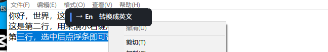
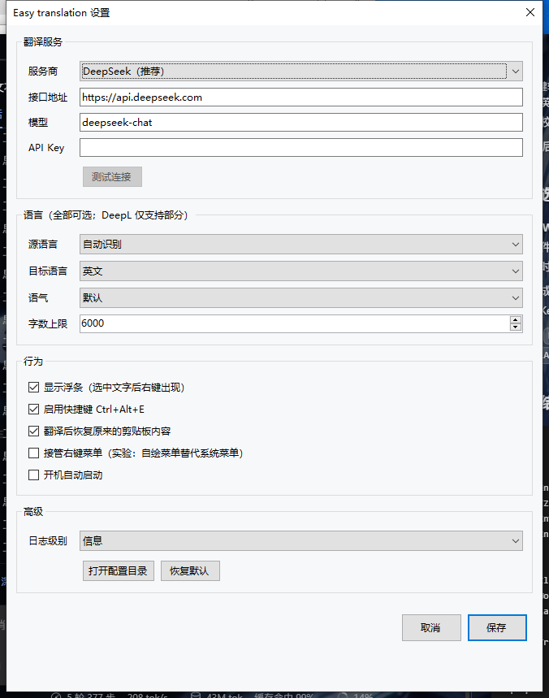

# Easy translation


Select text in **any Windows app or browser**, right-click, and click the floating **→ En** button. The selected text is translated and replaced in place — no copy/paste, no window switching.



- A small always-on-top chip appears next to the cursor; clicking it translates and replaces the selection
- The clipboard is snapshotted and restored; on failure the original text is left untouched
- `Ctrl+Z` undoes the replacement in apps that support undo
- Tray app with a settings window, hotkey, and optional autostart
- DeepSeek by default; any OpenAI-compatible endpoint; DeepL; `--echo` mode for trying the UI without a key
- **18 target languages**: Chinese, Traditional Chinese, English, Japanese, Korean, French, German, Spanish, Portuguese, Italian, Russian, Arabic, Thai, Vietnamese, Turkish, Indonesian, Dutch, Polish
- Source language is detected automatically; default direction is Chinese → English

[中文说明](README.md)

> **Why a floating chip instead of a native context-menu item?**
> Windows has no public API that lets a third-party app add an item to another app's text context menu (ITfMenu only works for IME language-bar menus, and Explorer verbs only apply to files). The app therefore uses a non-activating chip. An experimental "replace the native context menu" option is available in settings.

---

## Download

1. Open the [Releases](../../releases/latest) page and download `EasyTranslation-v*-win-x64.zip`.
2. Extract it anywhere.
3. Run `EasyTranslation.exe`. It stays in the system tray.

The release is a **self-contained single file** (~63 MB): no .NET installation and no administrator rights required.

Windows SmartScreen may warn about an unsigned executable. See [SmartScreen](#smartscreen) below.

## Build from source

Requires the [.NET 8 SDK](https://dotnet.microsoft.com/download/dotnet/8.0) on Windows x64.

```powershell
powershell -ExecutionPolicy Bypass -File .\build.ps1                 # framework-dependent
powershell -ExecutionPolicy Bypass -File .\build.ps1 -SelfContained  # ~63 MB, no .NET needed
powershell -ExecutionPolicy Bypass -File .\install\install.ps1       # install to %LOCALAPPDATA%\Programs\EasyTranslation
```

## First run

1. Tray icon (blue **L**) → **设置…** (Settings).
2. Pick a provider (DeepSeek by default), paste your API key, click **测试连接** (Test), then **保存** (Save).
3. Select text anywhere, right-click, click the chip.



No key? Run `.\publish\EasyTranslation.exe --echo`; it returns `[En] original text` locally and never touches the network.

## Usage

| Action | Description |
| --- | --- |
| Right-click after selecting text | The chip appears above the cursor and hides after 4 s |
| Click the chip | Translate and replace; the target window keeps focus |
| `Esc` | Cancel an in-flight translation |
| `Ctrl+Alt+E` | Fallback hotkey for the current selection |
| `Ctrl+Z` | Undo the replacement in the target app |
| Tray menu | Enable/disable, settings, open logs, autostart, quit |

## CLI

| Flag | Purpose |
| --- | --- |
| `--echo` | Local fake translation for testing the flow |
| `--debug` | Verbose logs (no selected text is recorded) |
| `--settings` | Open the settings window on startup |
| `--diagnose` | Write `diagnose.txt` and exit (environment/permission troubleshooting) |

## Configuration and logs

- `%APPDATA%\EasyTranslation\settings.json` (falls back to `%LOCALAPPDATA%`, the exe folder, then `%TEMP%`)
- Old `Zh2En` settings are migrated automatically on first launch
- Logs: `logs\app-yyyyMMdd.log`, 1 MB × 3
- API keys are encrypted with Windows DPAPI for the current user; logs never contain selected text

## Limitations

- Requires a text control that supports `Ctrl+C` / `Ctrl+V`; read-only pages (web articles, PDF viewers) can copy the translation but not replace the text.
- Windows running as administrator do not receive low-level hooks from a non-elevated process; run this app elevated if you really need it.
- Some UWP/Store apps have limited support for synthetic keystrokes; games and full-screen exclusive apps are not supported.
- Some apps' context menus do not close on `Esc` and may cover the chip; use `Ctrl+Alt+E` instead.
- DeepL supports only a subset of the 18 languages (no Thai/Vietnamese; Traditional Chinese as target only). DeepSeek and OpenAI-compatible providers support all of them.
- Translation quality depends on the model and language pair; try a short passage first.

## SmartScreen

Release executables are unsigned, so Windows may show "Windows protected your PC". This is expected:

1. **More info** → **Run anyway**.
2. If the file came from a browser, unblock it first: right-click → Properties → **Unblock**, or run `install\fix-smartscreen.ps1`.
3. To remove "Unknown publisher" on your own machine, run `sign.ps1` as administrator: it creates a self-signed certificate, trusts it in `TrustedPeople` (not the root store), and signs the exe. The certificate is trusted only on that machine.
4. Distributing a warning-free binary requires a real OV/EV code-signing certificate. `build.ps1` signs automatically when a matching certificate exists.

## Uninstall

```powershell
powershell -ExecutionPolicy Bypass -File .\uninstall\uninstall.ps1
# -KeepData keeps %APPDATA%\EasyTranslation
```

## Development

```
src/EasyTranslation.App    WinForms tray app (net8.0-windows, x64)
tests/EasyTranslation.Tests xUnit tests (language, chunking, config, selection, workflow)
tests/e2e/                 Notepad and Chrome end-to-end scripts
tools/make_icon.py         Generates assets/app.png and app.ico
docs/                      Architecture, acceptance notes, screenshots
```

```powershell
dotnet test tests/EasyTranslation.Tests/EasyTranslation.Tests.csproj
.\build.ps1
```

Current acceptance: **86/86 unit tests**, Notepad E2E, Chrome E2E, and a Japanese-target E2E all pass with `--echo`.

All `.ps1` files must be saved as **UTF-8 with BOM** — Windows PowerShell 5.1 otherwise parses Chinese literals as ANSI and fails.

## Privacy

- Selected text is sent to your configured translation provider only when you click the chip or press the hotkey.
- No telemetry; logs never contain the selected text.
- API keys stay on this machine, encrypted with DPAPI.

## License

[MIT](LICENSE) © 2026 Easy translation contributors
