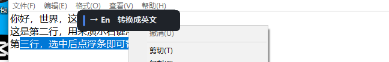
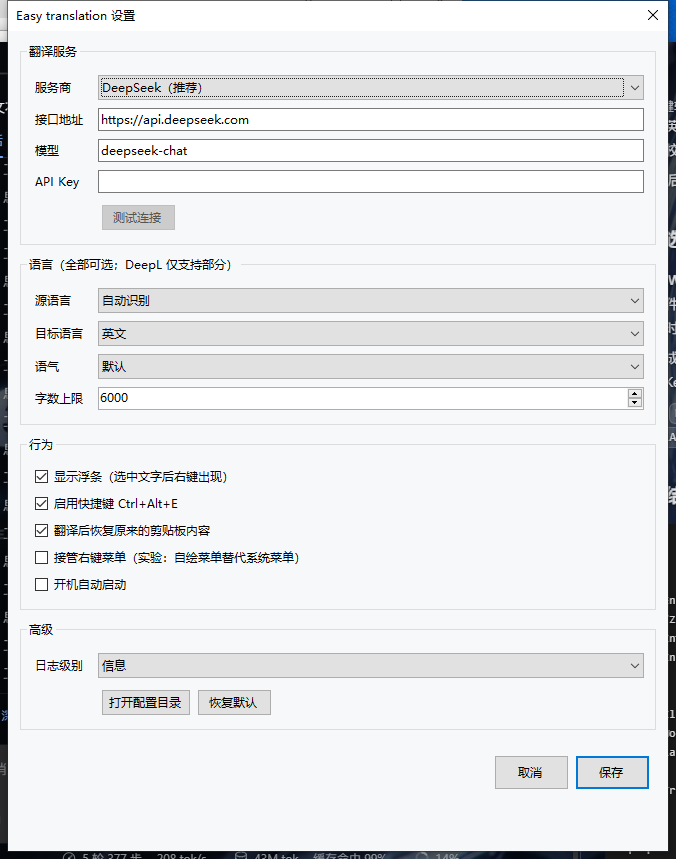

# Easy translation · 划词翻译替换


在任意 Windows 软件或浏览器里框选文字，**右键 → 点浮条「→ En　转换成英文」**，选中的文字会直接变成目标语言——不用复制、不用切换窗口。



- 浮条出现在鼠标旁边，点一下就翻译并**原地替换**选中文字
- 自动保存并恢复剪贴板；翻译或替换失败时原文保持不变
- `Ctrl+Z` 可撤销替换（取决于目标软件是否支持撤销）
- 托盘常驻，可设置翻译服务、目标语言、快捷键、开机启动
- 默认 DeepSeek，兼容 OpenAI 接口，也支持 DeepL；没有 Key 时可用 `--echo` 试运行
- 内置 **18 种目标语言**：中文、繁体中文、英文、日文、韩文、法文、德文、西班牙文、葡萄牙文、意大利文、俄文、阿拉伯文、泰文、越南文、土耳其文、印尼文、荷兰文、波兰文；默认中 → 英

[English README](README.en.md)

> **为什么是「浮条」而不是直接改右键菜单？**
> Windows 没有公开 API 能让第三方程序往**其他程序**的文本框右键菜单里加一项（ITfMenu 只作用于输入法语言栏，资源管理器右键菜单只对文件生效）。因此本工具使用一个不抢焦点的小浮条；设置里另有「接管右键菜单」实验选项，用自绘菜单代替系统菜单。

---

## 下载与安装（推荐）

1. 打开 [Releases](../../releases/latest) 页面，下载最新的 `EasyTranslation-v*-win-x64.zip`。
2. 解压到任意目录（例如 `D:\Tools\EasyTranslation`）。
3. 双击 `EasyTranslation.exe`。程序会常驻系统托盘，不弹主窗口。

发布包是**自包含单文件**（约 63 MB），不需要预装 .NET，也不需要管理员权限。

> 首次运行可能遇到 SmartScreen /「Windows 已保护你的电脑」，见下方 [SmartScreen 与杀毒软件](#smartscreen-与杀毒软件)。发布包没有代码签名证书，这个提示属于预期。

### 从源码构建

需要 [.NET 8 SDK](https://dotnet.microsoft.com/download/dotnet/8.0)（Windows x64）和 PowerShell 5.1+。

```powershell
# 构建 + 86 个单元测试 + 发布（框架依赖单文件，需 .NET 8 Desktop Runtime）
powershell -ExecutionPolicy Bypass -File .\build.ps1

# 想要和 Releases 一样的自包含版本（约 63 MB，无需 .NET）
powershell -ExecutionPolicy Bypass -File .\build.ps1 -SelfContained

# 安装到 %LOCALAPPDATA%\Programs\EasyTranslation 并创建开始菜单快捷方式
powershell -ExecutionPolicy Bypass -File .\install\install.ps1
# 可选：-DesktopShortcut 创建桌面快捷方式，-NoStart 安装后不启动
```

也可以直接运行 `publish\EasyTranslation.exe`，不安装。

## 首次配置

1. 在托盘找到蓝色 **L** 图标 → 右键 → **设置…**
2. 选择服务商（默认 DeepSeek），填入 **API Key** → **测试连接** → **保存**
   - DeepSeek Key 在 <https://platform.deepseek.com> 申请
3. 在任意软件里输入文字，鼠标框选，点右键，点浮条。



### 没有 API Key 也能先试

```powershell
.\publish\EasyTranslation.exe --echo
```

`--echo` 使用本地假翻译（返回 `[En] 原文`、`[日] 原文` 等），用来验证「框选 → 浮条 → 替换」整条链路，不联网、不花钱。

## 使用细节

| 操作 | 说明 |
| --- | --- |
| 框选后右键 | 浮条出现在光标上方；4 秒内不点会自动消失 |
| 点浮条 | 翻译并替换；浮条点击不会让目标窗口失焦 |
| `Esc` | 翻译过程中按 Esc 取消 |
| `Ctrl+Alt+E` | 兜底热键：对当前选中的文字直接翻译替换（设置里可关） |
| 右键菜单 | 默认保留系统菜单（浮条是伴侣）。可在设置里改为「接管右键菜单」实验模式 |
| 托盘菜单 | 启用/停用、设置、打开日志目录、开机自动启动、退出 |
| `Ctrl+Z` | 在目标软件里撤销刚完成的替换 |

设置项概览：

- **翻译服务**：服务商（DeepSeek / OpenAI 兼容 / DeepL）、接口地址、模型、API Key（DPAPI 加密保存）、测试连接
- **语言**：源语言（默认自动识别）、目标语言（18 种，默认英文）、语气（默认/正式/口语/技术）、字数上限
- **行为**：显示浮条、快捷键、恢复剪贴板、接管右键菜单（实验）、开机启动
- **高级**：日志级别、打开配置目录、恢复默认

## 命令行

| 参数 | 作用 |
| --- | --- |
| `--echo` | 使用假翻译，验证链路 |
| `--debug` | 输出调试日志（鼠标/流程细节，不含原文） |
| `--settings` | 启动后直接打开设置窗口 |
| `--diagnose` | 写 `diagnose.txt` 后退出，用于排查环境/权限问题 |

## 配置文件与日志

- 配置：`%APPDATA%\EasyTranslation\settings.json`（不可写时依次回退到 `%LOCALAPPDATA%\EasyTranslation`、程序目录 `data`、`%TEMP%\EasyTranslation`）
- 从旧版 `Zh2En` 升级时，首次启动会自动复制旧配置
- 日志：配置目录下 `logs\app-yyyyMMdd.log`，单文件 1 MB、保留 3 个
- API Key 用 Windows DPAPI（当前用户）加密；日志**不记录**选中的原文

## 翻译服务

| 服务商 | 接口地址示例 | 说明 |
| --- | --- | --- |
| DeepSeek（默认） | `https://api.deepseek.com` | 模型 `deepseek-chat`；请求路径 `/chat/completions` |
| OpenAI 兼容 | `https://api.openai.com/v1` 或本地 `http://127.0.0.1:11434/v1` | 任何兼容 `/chat/completions` 的服务（OpenAI、Ollama、LM Studio、vLLM 等） |
| DeepL | `https://api-free.deepl.com` | 需要 DeepL API Key；免费版用 `api-free.deepl.com` |

错误提示会区分：Key 无效（401）、余额不足（402）、限流（429）、网络超时等；失败时**不会**粘贴，原文保持不变。

## 已知限制

- 只能用于支持 `Ctrl+C` / `Ctrl+V` 的文本控件；网页正文、PDF 阅读器等只读区域可以复制出译文，但无法原地替换（译文会留在剪贴板）。
- 以管理员身份运行的窗口不会收到普通权限程序的全局钩子；如确实需要，请以管理员身份运行本程序（不推荐日常使用）。
- 部分 UWP / 商店应用对模拟按键支持有限；游戏、全屏独占程序不支持。
- 某些软件的右键菜单不会因 `Esc` 关闭，此时浮条可能被菜单遮挡；可改用 `Ctrl+Alt+E`。
- 18 种语言共用同一套提示词与链路；真实翻译质量取决于所选模型与语言对，建议先小段试译。
- DeepL 只支持部分语言方向（不支持泰文、越南文；繁体中文只能作目标语言），其余服务商（DeepSeek / OpenAI 兼容）支持全部 18 种。
- 只有框架依赖版本需要 .NET 8 Desktop Runtime；Releases 中的自包含版本不需要。

## SmartScreen 与杀毒软件

Windows 对没有正式代码签名的 exe 会显示「Windows 已保护你的电脑」。本项目没有购买 OV/EV 证书，Release 里的 exe 未签名，这个提示属于预期，不代表文件有问题：

1. 点「更多信息」→「仍要运行」。
2. 文件是从浏览器下载时，先解除下载锁定：右键文件 → 属性 → 勾选「解除锁定」；或运行
   `powershell -ExecutionPolicy Bypass -File install\fix-smartscreen.ps1`（会解除下载标记并显示签名状态）。
3. 想在本机消除「未知发布者」：以管理员运行 `sign.ps1`，它会生成自签名证书、加入本机 `TrustedPeople`，并给 `publish\EasyTranslation.exe` 签名；再运行 `install\install.ps1` 重新安装。证书只加入 **TrustedPeople**，不加入根证书存储，且只在本机受信任。
4. 要分发给其他人并消除提示：需要正式的 OV/EV 代码签名证书；`build.ps1` 检测到本机证书时会自动签名。

## 卸载

```powershell
powershell -ExecutionPolicy Bypass -File .\uninstall\uninstall.ps1
# 加 -KeepData 保留 %APPDATA%\EasyTranslation 下的配置和日志
```

卸载会结束进程、删除程序目录、开始菜单/桌面快捷方式、开机启动注册表项。

## 开发与测试

```
src/EasyTranslation.App          WinForms 托盘应用（net8.0-windows, x64）
  Interop/                       P/Invoke：钩子、SendInput、DPI、剪贴板、DPAPI
  Input/                         低层鼠标/键盘钩子、选区跟踪、菜单关闭、焦点守卫
  Clipboard/                     STA 剪贴板快照与还原
  Workflow/                      翻译替换状态机
  Languages/                     语言目录、脚本识别、拉丁语系猜词
  Translation/                   提示词、分块、后处理、HTTP 翻译器
  Ui/                            浮条、提示、自绘菜单、设置窗
  Tray/                          托盘
tests/EasyTranslation.Tests      xUnit 单元测试（语言、分块、配置、选区、工作流）
tests/e2e/e2e.ps1                记事本端到端（拖选→右键→点浮条→校验剪贴板/控件文本）
tests/e2e/chrome-e2e.ps1         Chrome 网页 textarea 端到端（自动启停 Chrome）
tools/make_icon.py               生成 assets/app.png 与 app.ico（蓝色 L）
docs/                            架构、验收记录、截图
```

```powershell
dotnet test tests/EasyTranslation.Tests/EasyTranslation.Tests.csproj
.\build.ps1
# E2E（先启动 publish\EasyTranslation.exe --echo --debug）
powershell -ExecutionPolicy Bypass -File .\tests\e2e\e2e.ps1
powershell -ExecutionPolicy Bypass -File .\tests\e2e\chrome-e2e.ps1
```

当前验收：**86/86 单元测试、记事本 E2E 通过、Chrome E2E 通过、日语目标 E2E 通过**（`--echo` 假翻译；真实翻译需填 Key 后人工抽测）。

E2E 依赖交互式桌面会话；脚本用 `mouse_event` 注入相对移动（`SetCursorPos` 不会触发低层鼠标钩子），并且**所有 .ps1 必须保存为 UTF-8 with BOM**，否则 Windows PowerShell 5.1 会把中文字面量按 ANSI 读乱（安装脚本也会因此解析失败）。

## 隐私

- 只有你主动点击浮条/热键时，选中的文字才会发送到你配置的翻译服务。
- 不在日志中记录原文；不收集遥测。
- API Key 仅保存在本机，使用当前 Windows 用户的 DPAPI 加密。

## 许可证

[MIT](LICENSE) © 2026 Easy translation contributors
